# Learner - diseño detallado

Complementa a [[Architecture]]. Define las clases internas del proceso Learner y la interfaz de cada una.

## Objetivo y principios

El objetivo es poder cambiar el modelo VLA, el algoritmo o la fuente de datos sin reescribir el resto. Debe ser lo bastante genérico para usar modelos como π0 u OpenVLA, y también modelos que aparezcan más adelante, sin modificar nada fuera del adaptador del modelo. Para eso, cada clase tiene una sola responsabilidad y conoce lo mínimo de las demás.

1. **Solo `VLAPolicy` conoce el modelo por dentro.** El resto del Learner trata al modelo como una caja que actúa, evalúa acciones y calcula su loss de imitación. Eso incluye cómo normaliza o tokeniza las acciones.
2. **Solo `Algorithm` conoce la loss.** BC, PPO y GRPO son clases intercambiables; ninguna sabe qué modelo hay debajo.
3. **Solo `CoreClient` habla por la red.** Ninguna otra clase importa ZeroMQ ni conoce direcciones.
4. **Solo `OptimizerManager` toca el optimizador.** Los algoritmos devuelven una loss; no llaman a `backward()` ni a `step()`.
5. **`Learner` solo orquesta.** No tiene lógica de modelo, de loss ni de red: conecta las piezas y corre el loop.
6. **Todo se construye desde configuración.** Cambiar de modelo o de algoritmo es cambiar un nombre en el YAML.

## Mapa de clases

```mermaid
classDiagram
    class Learner
    class VLAPolicy {
        <<interface>>
    }
    class ComposedPolicy
    class Backbone {
        <<interface>>
    }
    class ActionHead {
        <<interface>>
    }
    class ValueHead
    class ObservationProcessor {
        <<interface>>
    }
    class ActionNormalizer
    class Algorithm {
        <<interface>>
    }
    class AdvantageEstimator {
        <<interface>>
    }
    class DataSource {
        <<interface>>
    }
    class RolloutCollector
    class CoreClient

    Learner --> VLAPolicy
    Learner --> Algorithm
    Learner --> DataSource
    Learner --> MinibatchIterator
    Learner --> OptimizerManager
    Learner --> CheckpointManager
    Learner --> MetricsLogger
    Learner --> DistributedStrategy

    ComposedPolicy ..|> VLAPolicy
    ComposedPolicy --> Backbone
    ComposedPolicy --> ActionHead
    ComposedPolicy --> ValueHead
    ComposedPolicy --> ActionNormalizer
    VLAPolicy --> ObservationProcessor

    BehaviorCloning ..|> Algorithm
    PPO ..|> Algorithm
    GRPO ..|> Algorithm
    PPO --> AdvantageEstimator
    GRPO --> AdvantageEstimator
    GAE ..|> AdvantageEstimator
    GroupRelativeAdvantage ..|> AdvantageEstimator

    SupervisedSource ..|> DataSource
    EnvRolloutSource ..|> DataSource
    WorldModelRolloutSource ..|> DataSource
    MixedSource ..|> DataSource
    EnvRolloutSource --> RolloutCollector
    WorldModelRolloutSource --> RolloutCollector
    RolloutCollector --> CoreClient
    SupervisedSource --> CoreClient
```



|Grupo|Clase|Responsabilidad|
|---|---|---|
|Modelo|`VLAPolicy`|Interfaz única del modelo: actuar, evaluar acciones, loss de imitación|
|Modelo|`ComposedPolicy`|Implementación de `VLAPolicy` armada con backbone + cabeza de acción + cabeza de valor|
|Modelo|`Backbone`|Visión + lenguaje → features|
|Modelo|`ActionHead`|Features → acciones (tokens, diffusion, flow, gaussiana)|
|Modelo|`ValueHead`|Features → V(s)|
|Modelo|`ObservationProcessor`|`Observation` → tensores que entiende el modelo|
|Modelo|`ActionNormalizer`|Pieza reutilizable para normalizar acciones dentro de una política|
|Algoritmo|`Algorithm`|Interfaz: preparar el batch y calcular la loss|
|Algoritmo|`BehaviorCloning`, `PPO`, `GRPO`|Implementaciones concretas|
|Algoritmo|`AdvantageEstimator`|Recompensas → ventajas y retornos|
|Algoritmo|`ReferencePolicy`|Copia congelada del modelo para el término KL|
|Datos|`CoreClient`|Única puerta hacia Core|
|Datos|`DataSource`|Interfaz: entregar el siguiente batch|
|Datos|`RolloutCollector`|Loop de reset/act/step que produce rollouts|
|Datos|`MinibatchIterator`|Partir cualquier batch en minibatches|
|Infraestructura|`OptimizerManager`|Backward, clipping, paso del optimizador y scheduler|
|Infraestructura|`DistributedStrategy`|Una GPU, DDP o FSDP|
|Infraestructura|`CheckpointManager`|Guardar y cargar estado|
|Infraestructura|`MetricsLogger`|Publicar métricas|
|Orquestación|`Learner`|Conecta todo y corre el loop de entrenamiento|
|Orquestación|`Registry`|Construir cada pieza a partir de su nombre en la config|

## Tipos internos

Los tipos `Observation`, `Action`, `ActionChunk` y `Transition` vienen del documento de arquitectura. Dentro del Learner se trabaja con tensores agrupados en batch, así que se agregan estos:

```python
@dataclass
class ModelInput:
    """Salida de ObservationProcessor. Su contenido depende del modelo."""
    tensors: dict[str, Tensor]
    batch_size: int

@dataclass
class PolicyOutput:
    actions: Tensor               # [B, H, D] en unidades reales; H = largo del chunk
    log_probs: Tensor | None      # [B], log-prob del chunk completo
    values: Tensor | None         # [B], si el modelo tiene cabeza de valor
    extras: dict[str, Tensor] = field(default_factory=dict)  # datos propios del modelo

@dataclass
class ActionEvaluation:
    log_probs: Tensor             # [B]
    entropy: Tensor | None        # [B]
    values: Tensor | None         # [B]

@dataclass
class LossOutput:
    loss: Tensor
    metrics: dict[str, float]

class Batch(ABC):
    """Todo batch sabe su largo y cómo seleccionar un subconjunto de filas."""
    @abstractmethod
    def __len__(self) -> int: ...
    @abstractmethod
    def select(self, indices: Tensor) -> "Batch": ...

@dataclass
class SupervisedBatch(Batch):
    inputs: ModelInput
    actions: Tensor               # [B, H, D] en unidades reales

@dataclass
class RolloutBatch(Batch):
    inputs: ModelInput
    actions: Tensor               # [B, H, D] en unidades reales
    old_log_probs: Tensor         # [B], al momento de actuar
    rewards: Tensor               # [B]
    terminated: Tensor            # [B] bool
    truncated: Tensor             # [B] bool
    episode_ids: list[str]
    step_ids: Tensor              # [B], para ordenar dentro del episodio
    source: Literal["env", "world_model"]
    old_values: Tensor | None = None
    group_ids: Tensor | None = None   # para GRPO
    extras: dict[str, Tensor] = field(default_factory=dict)  # copiados de PolicyOutput
    advantages: Tensor | None = None  # lo llena Algorithm.prepare
    returns: Tensor | None = None     # lo llena Algorithm.prepare
```

Tres convenciones que atraviesan todo el Learner:

- **Un chunk es un paso.** La log-probabilidad de un chunk es la suma de las log-probabilidades de sus acciones. PPO y GRPO operan sobre esa suma.
- **Fuera de `VLAPolicy`, las acciones siempre están en unidades reales.** El Dataset las entrega así, Core las recibe así y los batches las guardan así. Cómo normaliza o tokeniza cada modelo es un detalle interno de su política (ver Normalización de acciones).
- **`extras` es el espacio propio del modelo.** Lo que el modelo necesite recordar entre `act` y `evaluate_actions` (por ejemplo, los ids de los tokens elegidos o el ruido inicial de un modelo de diffusion) viaja en `extras` sin que el resto del Learner lo interprete.

## Modelo

### `VLAPolicy`

Es la interfaz que todo modelo debe cumplir. Es la única que el resto del Learner usa.

```python
class Capability(Enum):
    LOG_PROB = "log_prob"         # puede calcular log π(a|s)
    VALUE = "value"               # tiene cabeza de valor
    ENTROPY = "entropy"           # puede calcular entropía

class VLAPolicy(nn.Module, ABC):
    processor: ObservationProcessor

    @property
    @abstractmethod
    def capabilities(self) -> set[Capability]: ...

    @property
    @abstractmethod
    def chunk_size(self) -> int: ...

    @property
    @abstractmethod
    def action_dim(self) -> int: ...

    @abstractmethod
    def act(self, inputs: ModelInput, deterministic: bool = False) -> PolicyOutput:
        """Genera acciones en unidades reales. Se llama sin gradientes durante los rollouts."""

    @abstractmethod
    def evaluate_actions(self, inputs: ModelInput, actions: Tensor,
                         extras: dict[str, Tensor] | None = None) -> ActionEvaluation:
        """Log-prob, entropía y valor de acciones ya tomadas (unidades reales). Con gradientes."""

    @abstractmethod
    def imitation_loss(self, inputs: ModelInput, actions: Tensor) -> LossOutput:
        """Loss de BC propia del modelo (cross-entropy, denoising, flow matching...)."""

    def trainable_parameters(self) -> Iterable[nn.Parameter]:
        return (p for p in self.parameters() if p.requires_grad)

    def clone_frozen(self) -> "VLAPolicy":
        """Copia sin gradientes, para ReferencePolicy."""

    @abstractmethod
    def save_pretrained(self, directory: Path) -> None:
        """Guarda pesos, configuración y estadísticas de normalización."""

    @classmethod
    @abstractmethod
    def from_pretrained(cls, directory: Path) -> "VLAPolicy": ...
```

Por qué `imitation_loss` vive en el modelo y no en `BehaviorCloning`: cada tipo de cabeza imita de forma distinta. Un modelo con tokens usa cross-entropy, uno con diffusion usa la loss de denoising. Si BC calculara la loss, tendría que conocer el modelo.

Si una capacidad no está, el método correspondiente lanza `NotImplementedError`. El `Learner` revisa las capacidades al arrancar (ver Compatibilidad).

**`deterministic=True`.** Dos llamadas a `act` con la misma entrada deben dar el mismo resultado (POL-04). En modelos con ruido (diffusion, flow), la política fija el ruido inicial con un generador de números aleatorios de semilla constante propio de la política, sin tocar el estado aleatorio global de PyTorch. Así el determinismo no depende de sembrar afuera ni altera el muestreo estocástico del resto del proceso.

### `ComposedPolicy`

La mayoría de los VLAs se pueden ver como backbone + cabeza de acción. `ComposedPolicy` implementa `VLAPolicy` a partir de esas piezas, para reutilizar un backbone con varias cabezas o al revés.

```python
class Backbone(nn.Module, ABC):
    @abstractmethod
    def encode(self, inputs: ModelInput) -> Tensor:
        """Features [B, T, F] a partir de imágenes, propiocepción e instrucción."""

    @property
    @abstractmethod
    def feature_dim(self) -> int: ...

class ActionHead(nn.Module, ABC):
    """Trabaja siempre con acciones normalizadas; ComposedPolicy normaliza antes y desnormaliza después."""

    @property
    @abstractmethod
    def capabilities(self) -> set[Capability]: ...

    @abstractmethod
    def sample(self, features: Tensor, deterministic: bool) -> tuple[Tensor, Tensor | None, dict]:
        """Devuelve (acciones normalizadas [B, H, D], log_probs [B] o None, extras)."""

    @abstractmethod
    def log_prob(self, features: Tensor, actions: Tensor, extras: dict | None) -> Tensor: ...

    @abstractmethod
    def entropy(self, features: Tensor) -> Tensor: ...

    @abstractmethod
    def bc_loss(self, features: Tensor, actions: Tensor) -> LossOutput: ...

class ValueHead(nn.Module):
    def __init__(self, feature_dim: int, hidden_dim: int): ...
    def forward(self, features: Tensor) -> Tensor:
        """V(s) [B]."""

class ComposedPolicy(VLAPolicy):
    def __init__(
        self,
        backbone: Backbone,
        action_head: ActionHead,
        processor: ObservationProcessor,
        normalizer: ActionNormalizer,
        value_head: ValueHead | None = None,
    ): ...
    # capabilities = action_head.capabilities ∪ {VALUE si hay value_head}
    # act: encode → action_head.sample → normalizer.denormalize
    # evaluate_actions e imitation_loss: normalizer.normalize → encode → cabezas
```

Cabezas de acción previstas:

|Cabeza|Cómo genera|`LOG_PROB`|Loss de BC|
|---|---|---|---|
|`TokenActionHead`|Acciones discretizadas como tokens, autoregresivo|Sí|Cross-entropy|
|`GaussianActionHead`|Media y desviación por dimensión|Sí|Log-likelihood negativa|
|`DiffusionActionHead`|Denoising iterativo|No|Denoising (MSE sobre ruido)|
|`FlowMatchingActionHead`|Integración de un campo de velocidad|No|Flow matching|

**Modelos que no se pueden separar.** Si un VLA preentrenado viene como un bloque y no conviene partirlo, se implementa `VLAPolicy` directo con un adaptador (por ejemplo `OpenVLAPolicy`). El resto del Learner no nota la diferencia.

**Congelar y LoRA.** Se decide al construir la política: el factory congela el backbone o le aplica LoRA, y `trainable_parameters()` devuelve solo lo que se entrena. Ni el algoritmo ni el optimizador saben que hay partes congeladas.

### `ObservationProcessor`

Convierte observaciones del formato común al formato del modelo. Es propio de cada modelo: tamaño de imagen, normalización de píxeles, tokenizador de la instrucción, qué cámaras usa. También es aquí donde se normaliza la propiocepción, si el modelo la usa.

```python
class ObservationProcessor(ABC):
    @abstractmethod
    def __call__(self, observations: list[Observation]) -> ModelInput: ...

    @property
    @abstractmethod
    def required_cameras(self) -> list[str]: ...

    def to(self, device: torch.device) -> "ObservationProcessor": ...
```

### Normalización de acciones

**Decisión:** la normalización de acciones queda dentro de cada `VLAPolicy`, y el resto del harness trabaja en unidades reales.

El motivo es que no hay una convención común entre los modelos que se pueden importar desde Hugging Face. Todos normalizan, pero cada uno a su manera:

- **OpenVLA** discretiza cada dimensión en 256 bins y guarda las estadísticas de cada dataset de preentrenamiento en su configuración. Al predecir, se le indica qué estadísticas usar para devolver acciones en unidades reales.
- **Las políticas de LeRobot** (π0, ACT, Diffusion Policy) guardan las estadísticas del dataset junto a la política y normalizan entradas y salidas en su propio pipeline.
- **openpi** (la implementación de Physical Intelligence de π0) carga un archivo de estadísticas por dataset y normaliza en sus transformaciones.

Si el harness impusiera una normalización propia, habría que desactivar la del modelo o normalizar dos veces. Dejándola dentro de la política, un adaptador de un modelo de Hugging Face simplemente usa la que el modelo ya trae, y `ComposedPolicy` usa `ActionNormalizer`.

Para RL esto no cambia nada: `evaluate_actions` recibe acciones en unidades reales y la política las normaliza igual que lo hizo en `act`. Para evitar errores de redondeo al re-tokenizar, la política puede guardar en `extras` lo que eligió (por ejemplo, los ids de los tokens) y usarlo directamente al evaluar.

### `ActionNormalizer`

Pieza reutilizable que usan `ComposedPolicy` y los adaptadores que no traen normalización propia.

```python
class ActionNormalizer(nn.Module):
    def __init__(self, stats: dict[str, ActionStats], mode: Literal["mean_std", "min_max", "quantile"]): ...

    def normalize(self, actions: Tensor, embodiment: str) -> Tensor: ...
    def denormalize(self, actions: Tensor, embodiment: str) -> Tensor: ...

    @classmethod
    def from_file(cls, path: Path) -> "ActionNormalizer": ...

    @classmethod
    def fit(cls, samples: list[tuple[Observation, ActionChunk]], mode: str) -> "ActionNormalizer":
        """Calcula estadísticas a partir de muestras del Dataset (vía sample_supervised)."""
```

Las estadísticas se registran como buffers del módulo, así que se guardan y cargan junto con los pesos.

De dónde salen las estadísticas, en orden de preferencia:

1. Las que trae el modelo preentrenado, si se entrena con el mismo tipo de datos.
2. Un archivo de estadísticas indicado en la configuración.
3. Calculadas al arrancar con `ActionNormalizer.fit`, a partir de una muestra del Dataset pedida a Core.

## Algoritmos

### `Algorithm`

Cada algoritmo declara qué datos necesita, qué capacidades exige del modelo, cómo prepara el batch y cómo calcula la loss.

```python
class Algorithm(ABC):
    @property
    @abstractmethod
    def required_capabilities(self) -> set[Capability]: ...

    @property
    @abstractmethod
    def batch_type(self) -> type[Batch]:
        """SupervisedBatch o RolloutBatch."""

    def prepare(self, batch: Batch, policy: VLAPolicy) -> Batch:
        """Trabajo previo a las actualizaciones, sin gradientes. Por defecto no hace nada."""
        return batch

    @abstractmethod
    def loss(self, policy: VLAPolicy, batch: Batch) -> LossOutput: ...

    @property
    def update_epochs(self) -> int:
        """Cuántas pasadas sobre el mismo batch. 1 para BC."""
        return 1

    @property
    def minibatch_size(self) -> int | None:
        """None = el batch completo."""
        return None

    def should_stop_epochs(self, metrics: dict[str, float]) -> bool:
        """El Learner lo consulta tras cada época; si devuelve True, corta las
        épocas restantes de esta iteración. Por defecto no corta nunca."""
        return False
```

### `BehaviorCloning`

```python
class BehaviorCloning(Algorithm):
    required_capabilities = set()
    batch_type = SupervisedBatch

    def loss(self, policy, batch):
        return policy.imitation_loss(batch.inputs, batch.actions)
```

Funciona con cualquier modelo, porque la loss la pone el modelo.

### `PPO`

```python
@dataclass
class PPOConfig:
    clip_ratio: float = 0.2
    value_coef: float = 0.5
    entropy_coef: float = 0.0
    update_epochs: int = 4
    minibatch_size: int = 64
    value_clip: float | None = None
    target_kl: float | None = None      # corta las épocas si el KL se pasa

class PPO(Algorithm):
    required_capabilities = {Capability.LOG_PROB, Capability.VALUE}
    batch_type = RolloutBatch

    def __init__(self, config: PPOConfig, advantage_estimator: AdvantageEstimator): ...

    def prepare(self, batch, policy):
        # 1. valores de los estados siguientes para el bootstrap
        # 2. advantage_estimator.compute → advantages, returns
        # 3. normaliza ventajas
        ...

    def loss(self, policy, batch):
        # ev = policy.evaluate_actions(batch.inputs, batch.actions, batch.extras)
        # ratio = exp(ev.log_probs - batch.old_log_probs)
        # loss = -min(ratio * A, clip(ratio) * A) + value_coef * value_loss - entropy_coef * H
        # métricas: approx_kl, clip_fraction, value_loss, entropy
        ...

    def should_stop_epochs(self, metrics):
        # corta las épocas si el KL aproximado se pasa de target_kl
        return self.config.target_kl is not None and metrics["approx_kl"] > self.config.target_kl
```

### `GRPO`

GRPO no usa cabeza de valor: compara cada rollout con otros que partieron del mismo estado inicial. Encaja bien con `simulate`, que ya genera varias secuencias desde un mismo punto.

```python
@dataclass
class GRPOConfig:
    group_size: int = 8
    clip_ratio: float = 0.2
    kl_coef: float = 0.0                # 0 = sin ReferencePolicy
    update_epochs: int = 1
    minibatch_size: int = 64

class GRPO(Algorithm):
    required_capabilities = {Capability.LOG_PROB}
    batch_type = RolloutBatch

    def __init__(
        self,
        config: GRPOConfig,
        advantage_estimator: GroupRelativeAdvantage,
        reference: ReferencePolicy | None = None,
    ): ...

    def prepare(self, batch, policy):
        # exige batch.group_ids; ventajas = (R - media del grupo) / std del grupo
        ...

    def loss(self, policy, batch):
        # misma pérdida recortada que PPO, sin término de valor
        # + kl_coef * KL(policy || reference) si hay referencia
        ...
```

Cómo se forman los grupos:

- **En el ambiente:** `EnvRolloutSource` hace `reset` de `group_size` ambientes con la misma tarea y la misma semilla.
- **En el WorldModel:** `WorldModelRolloutSource` pide `group_size` secuencias desde el mismo punto de partida.

### `AdvantageEstimator`

```python
class AdvantageEstimator(ABC):
    @abstractmethod
    def compute(self, batch: RolloutBatch) -> tuple[Tensor, Tensor]:
        """Devuelve (advantages [B], returns [B])."""

class GAE(AdvantageEstimator):
    def __init__(self, gamma: float = 0.99, lam: float = 0.95): ...
    # usa old_values y respeta terminated vs truncated:
    # terminated corta el bootstrap, truncated no

class GroupRelativeAdvantage(AdvantageEstimator):
    def __init__(self, normalize_std: bool = True): ...

class MonteCarloReturn(AdvantageEstimator):
    def __init__(self, gamma: float = 0.99): ...
```

### `ReferencePolicy`

```python
class ReferencePolicy:
    def __init__(self, policy: VLAPolicy):
        self.model = policy.clone_frozen()

    @torch.no_grad()
    def log_probs(self, inputs: ModelInput, actions: Tensor, extras: dict | None = None) -> Tensor: ...
```

Duplica la memoria del modelo, así que solo se crea si `kl_coef > 0`.

### Agregar un algoritmo nuevo

Se implementa `Algorithm` con sus tres decisiones: qué capacidades exige, qué tipo de batch consume y qué loss calcula. Por ejemplo, para cabezas sin log-prob (diffusion o flow) se puede agregar un `RewardWeightedBC` que pondera la loss de imitación por la recompensa: exige solo `imitation_loss` y consume `RolloutBatch`.

## Datos

### `CoreClient`

Es la única clase que conoce el protocolo ZeroMQ. Expone exactamente la interfaz de Core del documento de arquitectura.

```python
class CoreClient:
    def __init__(self, address: str, timeout_s: float): ...

    def reset(self, env_ids: list[str], task: str | None = None, seed: int | None = None) -> list[tuple[str, Observation]]: ...
    def step(self, env_ids: list[str], actions: list[ActionChunk], with_reward: bool) -> list[StepResult]: ...
    def simulate(self, start: Observation | tuple[str, int], action_sequences: list[list[ActionChunk]], with_reward: bool) -> list[list[StepResult]]: ...
    def sample_supervised(self, n: int, filters: dict | None = None) -> list[tuple[Observation, ActionChunk]]: ...
    def get_episode(self, episode_id: str) -> list[Transition]: ...

    def close(self) -> None: ...
```

Para tests se puede reemplazar por un `FakeCoreClient` en memoria con la misma interfaz, y probar el Learner sin levantar ningún otro proceso.

### `DataSource`

```python
class DataSource(ABC):
    @property
    @abstractmethod
    def batch_type(self) -> type[Batch]: ...

    @abstractmethod
    def next_batch(self, policy: VLAPolicy) -> Batch:
        """Recibe la política porque las fuentes de rollouts la usan para actuar."""
```

Implementaciones:

```python
class SupervisedSource(DataSource):
    def __init__(self, client: CoreClient, batch_size: int, filters: dict | None = None): ...
    # sample_supervised → policy.processor → SupervisedBatch (acciones en unidades reales)

class EnvRolloutSource(DataSource):
    def __init__(self, collector: RolloutCollector, env_ids: list[str], steps_per_batch: int, group_size: int = 1): ...

class WorldModelRolloutSource(DataSource):
    def __init__(self, collector: RolloutCollector, start_selector: StartSelector, sequences_per_start: int, horizon: int): ...

class MixedSource(DataSource):
    def __init__(self, sources: list[DataSource], weights: list[float]): ...
    # todas las fuentes deben tener el mismo batch_type
```

`StartSelector` decide desde dónde simular: una observación real reciente o un paso de un episodio registrado.

```python
class StartSelector(ABC):
    @abstractmethod
    def select(self, n: int) -> list[Observation | tuple[str, int]]: ...
```

### `RolloutCollector`

Corre el loop de interacción. Es la única clase que llama `policy.act`.

```python
class RolloutCollector:
    def __init__(self, client: CoreClient): ...

    @torch.no_grad()
    def collect_env(self, policy: VLAPolicy, env_ids: list[str], num_steps: int,
                    task: str | None = None, seed: int | None = None) -> RolloutBatch:
        # reset → loop: processor → act → tensor a ActionChunk → step
        # guarda old_log_probs, old_values y extras; reinicia ambientes terminados

    @torch.no_grad()
    def collect_world_model(self, policy: VLAPolicy, starts: list, sequences_per_start: int,
                            horizon: int) -> RolloutBatch:
        # genera secuencias candidatas con act → simulate → arma grupos
```

Pone la política en modo `eval()` mientras recolecta y la devuelve a `train()` al terminar. Como `act` ya devuelve unidades reales, la conversión a `ActionChunk` es solo un cambio de formato.

### `MinibatchIterator`

En cada iteración el Learner recibe un batch y, según el algoritmo, lo recorre en partes más chicas (minibatches) una o varias veces. PPO, por ejemplo, hace 4 pasadas en minibatches de 64. BC hace una pasada.

Esa lógica de partir es la misma sin importar el tipo de batch, así que vive en una sola clase. Funciona con cualquier `Batch` porque solo usa `__len__` y `select`.

```python
class MinibatchIterator:
    def __init__(self, batch: Batch, size: int | None, shuffle: bool = True): ...

    def __iter__(self) -> Iterator[Batch]:
        # permuta índices y entrega batch.select(indices[i:i+size])
        # size=None entrega el batch completo una vez
```

No guarda datos entre iteraciones: v1 es síncrono y on-policy, así que cada batch se usa en su iteración y se descarta.

## Infraestructura

### `OptimizerManager`

Concentra todo lo que pasa después de calcular la loss.

```python
@dataclass
class OptimizerConfig:
    name: str = "adamw"
    lr: float = 1e-5
    weight_decay: float = 0.0
    grad_clip: float | None = 1.0
    scheduler: str | None = "cosine"
    warmup_steps: int = 0
    precision: Literal["fp32", "bf16", "fp16"] = "bf16"
    grad_accumulation: int = 1

class OptimizerManager:
    def __init__(self, params: Iterable[nn.Parameter], config: OptimizerConfig): ...

    def step(self, loss: Tensor) -> dict[str, float]:
        """backward (con escala si fp16), acumulación, clipping, paso, scheduler, zero_grad.
        Devuelve métricas: grad_norm, lr."""

    def autocast(self) -> ContextManager: ...
    def state_dict(self) -> dict: ...
    def load_state_dict(self, state: dict) -> None: ...
```

### `DistributedStrategy`

```python
class DistributedStrategy(ABC):
    @abstractmethod
    def wrap(self, policy: VLAPolicy) -> VLAPolicy: ...
    @property
    @abstractmethod
    def is_main(self) -> bool: ...
    @abstractmethod
    def barrier(self) -> None: ...
    @abstractmethod
    def reduce_metrics(self, metrics: dict[str, float]) -> dict[str, float]: ...
    @abstractmethod
    def full_state_dict(self, policy: VLAPolicy) -> dict:
        """Reúne los pesos completos (necesario con FSDP antes de guardar)."""

class SingleDevice(DistributedStrategy): ...
class DDPStrategy(DistributedStrategy): ...
class FSDPStrategy(DistributedStrategy): ...
```

### `CheckpointManager`

Guarda por separado lo que necesita la evaluación y lo que necesita retomar el entrenamiento.

```python
class CheckpointManager:
    def __init__(self, directory: Path, keep_last: int = 3): ...

    def save(self, step: int, policy: VLAPolicy, optimizer: OptimizerManager,
             strategy: DistributedStrategy, config: dict) -> Path: ...
    def load_training_state(self, path: Path, policy: VLAPolicy, optimizer: OptimizerManager) -> int:
        """Devuelve el paso en que quedó."""
    def latest(self) -> Path | None: ...
```

Estructura de cada checkpoint:

```
checkpoints/step_000500/
├── policy/                 # escrito por policy.save_pretrained
│   ├── weights.safetensors # pesos del modelo, incluidas las estadísticas de normalización
│   └── config.yaml         # lo necesario para reconstruir la política con Registry
└── training_state.pt       # optimizador, scheduler, paso, semillas
```

El model server de evaluación solo lee la carpeta `policy/`. Cada política decide qué guarda ahí: un adaptador de un modelo de Hugging Face puede guardar en su formato original.

### `MetricsLogger`

```python
class MetricsLogger(ABC):
    @abstractmethod
    def log(self, metrics: dict[str, float], step: int) -> None: ...
    def close(self) -> None: ...

class StdoutLogger(MetricsLogger): ...
class WandbLogger(MetricsLogger): ...
class TensorBoardLogger(MetricsLogger): ...
```

Solo el proceso principal (`strategy.is_main`) publica.

## `Learner`

Orquesta todo. No tiene lógica propia más allá del loop.

```python
class Learner:
    def __init__(
        self,
        policy: VLAPolicy,
        algorithm: Algorithm,
        data_source: DataSource,
        optimizer: OptimizerManager,
        checkpoints: CheckpointManager,
        logger: MetricsLogger,
        strategy: DistributedStrategy,
        config: LearnerConfig,
    ):
        self._check_compatibility()   # capacidades y tipo de batch

    @classmethod
    def from_config(cls, config: dict) -> "Learner": ...

    def train(self, num_iterations: int) -> None:
        for it in range(self.start_iteration, num_iterations):
            batch = self.data_source.next_batch(self.policy)
            batch = self.algorithm.prepare(batch, self.policy)
            for _ in range(self.algorithm.update_epochs):
                for mb in MinibatchIterator(batch, self.algorithm.minibatch_size):
                    with self.optimizer.autocast():
                        out = self.algorithm.loss(self.policy, mb)
                    metrics = {**out.metrics, **self.optimizer.step(out.loss)}
                if self.algorithm.should_stop_epochs(metrics):
                    break   # p. ej. PPO corta si approx_kl > target_kl
            self._log(metrics, it)
            if it % self.config.checkpoint_every == 0:
                self.checkpoints.save(it, self.policy, self.optimizer, self.strategy, self.config.raw)

    def resume(self, path: Path | None = None) -> None: ...
    def _check_compatibility(self) -> None: ...
```

`_check_compatibility` falla al arrancar, no a mitad del entrenamiento, si:

- `algorithm.required_capabilities` no está contenido en `policy.capabilities`.
- `algorithm.batch_type` no coincide con `data_source.batch_type`.
- `policy.processor.required_cameras` pide cámaras que el embodiment no tiene.

## Construcción desde configuración

Cada pieza se registra con un nombre y se construye desde el YAML.

Un único registro anidado por `kind` (`policy`, `backbone`, `action_head`, `processor`, `algorithm`, `data_source`, ...) guarda la factory de cada nombre. Así se agregan nuevos `kind` sin tocar la clase.

```python
Factory = Callable[..., Any]

class Registry:
    _registries: dict[str, dict[str, Factory]] = {}

    @classmethod
    def register(cls, kind: str, name: str) -> Callable[[Factory], Factory]:
        """Decorador. Registrar dos veces el mismo (kind, name) lanza ValueError."""

    @classmethod
    def build(cls, kind: str, config: dict) -> Any:
        """Construye config['type']; el resto de claves van como kwargs de la
        factory. Un type desconocido lanza KeyError listando los disponibles."""

    @classmethod
    def available(cls, kind: str) -> list[str]:
        """Nombres registrados para un kind, ordenados."""

@Registry.register("algorithm", "ppo")
class PPO(Algorithm): ...
```

Ejemplo de configuración con una política compuesta:

```yaml
policy:
  type: composed
  backbone: {type: paligemma, checkpoint: google/paligemma-3b, freeze: true}
  action_head: {type: token, bins: 256, chunk_size: 8}
  value_head: {hidden_dim: 512}
  processor: {type: paligemma, cameras: [front, wrist], image_size: 224}
  normalizer: {mode: quantile, stats: fit}   # fit | ruta a un archivo

algorithm:
  type: ppo
  clip_ratio: 0.2
  update_epochs: 4
  minibatch_size: 64
  advantage: {type: gae, gamma: 0.99, lam: 0.95}

data:
  type: env_rollout
  env_ids: [sim-0, sim-1, sim-2, sim-3]
  steps_per_batch: 256

optimizer: {name: adamw, lr: 1.0e-5, grad_clip: 1.0, precision: bf16}
core: {address: "ipc:///tmp/core.sock", timeout_s: 30}
checkpoint: {directory: checkpoints/, every: 500}
```

Con un adaptador de un modelo existente, solo cambia el bloque `policy`:

```yaml
policy:
  type: openvla
  checkpoint: openvla/openvla-7b
  lora: {rank: 32}
```

## Cómo encajan modelos conocidos

El primer modelo se elige al implementar. Esta tabla sirve para comprobar que la interfaz es lo bastante genérica: cada modelo entra con un adaptador y nada más cambia.

|Modelo|Cómo se integra|Cabeza|`LOG_PROB`|Algoritmos que admite|
|---|---|---|---|---|
|OpenVLA|Adaptador `VLAPolicy` sobre el modelo de Hugging Face|Tokens (256 bins)|Sí|BC, GRPO; PPO agregando una `ValueHead`|
|π0 / π0.5|Adaptador sobre la versión de LeRobot u openpi, o `ComposedPolicy` con backbone PaliGemma y `FlowMatchingActionHead`|Flow matching|No|BC, `RewardWeightedBC`|
|Octo|Adaptador o `ComposedPolicy` con `DiffusionActionHead`|Diffusion|No|BC, `RewardWeightedBC`|
|Políticas de LeRobot (ACT, Diffusion Policy)|Adaptador genérico sobre `PreTrainedPolicy` de LeRobot|Según la política|Según la política|Según capacidades|

Si la investigación lleva a un modelo nuevo, el trabajo es siempre el mismo: escribir su adaptador y su `ObservationProcessor`, declarar sus capacidades y registrarlo. Si además se quiere hacer RL con un modelo sin `LOG_PROB`, se agrega un `Algorithm` que no lo necesite; el campo `extras` permite que ese algoritmo reciba datos propios del modelo (por ejemplo, el ruido usado al generar) sin cambiar ninguna otra interfaz.

## Qué cambia en cada caso

|Quiero cambiar|Qué se implementa|Qué no se toca|
|---|---|---|
|El modelo completo|Un `VLAPolicy` (o backbone + cabeza) y su `ObservationProcessor`|Algoritmos, datos, optimizador, checkpoints|
|Solo la cabeza de acción|Un `ActionHead`|Backbone, procesador y todo lo demás|
|El algoritmo de RL|Un `Algorithm` (y si hace falta un `AdvantageEstimator`)|Modelo, datos, infraestructura|
|SL ↔ RL|Config: `algorithm` y `data`|Todo el código|
|Entrenar en ambiente ↔ WorldModel|Config: `data.type`|Todo el código|
|Una o varias GPUs|Config: `DistributedStrategy`|Todo lo demás|
|El protocolo hacia Core|`CoreClient`|Todo lo demás|

## Compatibilidad entre algoritmos y cabezas

|Algoritmo|Necesita|Token|Gaussiana|Diffusion|Flow matching|
|---|---|---|---|---|---|
|`BehaviorCloning`|`imitation_loss`|Sí|Sí|Sí|Sí|
|`PPO`|`LOG_PROB`, `VALUE`|Sí, con `ValueHead`|Sí, con `ValueHead`|No|No|
|`GRPO`|`LOG_PROB`|Sí|Sí|No|No|
|`RewardWeightedBC` (futuro)|`imitation_loss`|Sí|Sí|Sí|Sí|

## Evaluación

`EvalModelServer` es un componente **opcional**, fuera del alcance base del harness (ver Alcance en `CLAUDE.md`): solo se implementa si se pide explícitamente, como dependencia opcional. Su suite de contrato (EVAL en `Test Learners.md`) solo corre cuando existe. Esta sección documenta el diseño para cuando llegue el momento.

El checkpoint guarda todo lo necesario para reconstruir la política, así que basta un único wrapper genérico para vla-evaluation-harness, válido para cualquier modelo:

```python
class EvalModelServer(PredictModelServer):
    def __init__(self, checkpoint_dir: Path):
        config = load_yaml(checkpoint_dir / "policy" / "config.yaml")
        policy_cls = Registry.policies[config["type"]]
        self.policy = policy_cls.from_pretrained(checkpoint_dir / "policy")
        self.policy.eval()

    def predict(self, obs, ctx):
        # obs del benchmark → Observation → processor → act(deterministic=True)
        # → acciones ya en unidades reales → formato de acción del benchmark

    def get_observation_spec(self): ...   # desde processor.required_cameras
    def get_action_spec(self): ...        # desde chunk_size y action_dim
```

Lo único específico de cada benchmark es la traducción de su observación a `Observation`, que se resuelve dentro de `predict`.